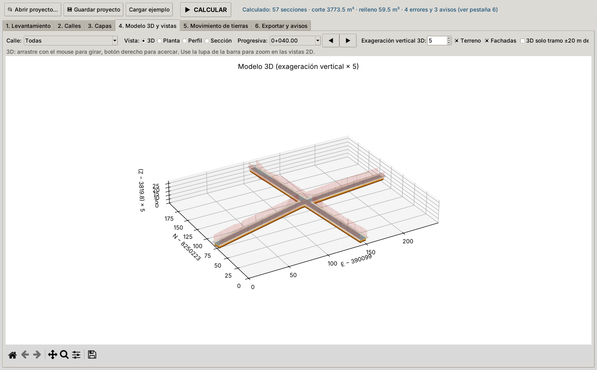

# Corredor Simple: pistas y veredas para Civil 3D

Con tres datos (el **eje** en planta, el **perfil** de rasante y la **sección típica** con sus capas)
la app arma el corredor completo de cada calle de una malla urbana. Entrega:

- coordenadas y cotas de todos los puntos de la sección (eje, bordes de calzada, cuneta, sardinel,
  vereda y pie de fachada), cada 10 m y en cada cambio de pendiente;
- cotas de cada capa y tablas de campo con la lectura de mira;
- avisos de vereda que choca con una fachada, de puertas que quedarían enterradas y de cocheras;
- corte, relleno (área media) y volumen de material por capa;
- **salidas para Civil 3D 2025**: LandXML (alineamientos, perfiles y superficies nativas), DXF 3D
  con hojas de secciones y perfil, y puntos en formato PNEZD;
- informe en Excel y PDF, y CSV para la estación total.



## Cómo usarla

**Opción 1, sin instalar nada aparte de Python.** Instala Python 3.12 desde python.org (marca
*tcl/tk* y *Add to PATH*) y haz doble clic en `iniciar.bat`.

**Opción 2, crear el ejecutable.** Haz doble clic en `construir_exe.bat`. Corre las pruebas y deja
el programa en `dist\CorredorSimple\CorredorSimple.exe`.

**Opción 3, por consola, sin ventana.**

```bash
python CorredorSimple.py calcular datos_ejemplo salida BM-01 1.425
```

### Pasos en la ventana

1. **Cargar ejemplo** o **Abrir proyecto**: el proyecto es una carpeta con los CSV (ver `datos_ejemplo/`).
2. Pestaña **1. Levantamiento**: importar terreno, fachadas, puertas/cocheras y BM.
3. Pestaña **2. Calles**: una fila por calle (nombre, bombeo %, ancho de calzada, ancho de vereda).
   - El eje se define con el **punto de origen + azimut + longitud** o con vértices.
   - El perfil se define por tramos (progresiva, cota inicial, pendiente %).
   - Edición con doble clic.
4. Pestaña **3. Capas**: capas de calzada y de vereda (cm), la cuneta básica y todos los parámetros.
5. **CALCULAR**.
6. Pestaña **4. Modelo 3D y vistas**: 3D (girar con el mouse), planta, perfil y sección en cualquier progresiva.
7. Pestaña **5. Movimiento de tierras**: tabla por calle y resumen total, con exportación a Excel o PDF.
8. Pestaña **6. Exportar y avisos**: BM y lectura atrás para la lectura de mira, **EXPORTAR TODO**
   y la lista de avisos.

Cómo llevar todo a Civil 3D y qué comparar: **[docs/CIVIL3D.md](docs/CIVIL3D.md)**.
Cuentas verificadas a mano: **[docs/VERIFICACION.md](docs/VERIFICACION.md)**.

## Consideraciones de diseño (supuestos que conviene confirmar)

| Tema | Lo que hace la app | Dónde se cambia |
|---|---|---|
| Sección | Calzada con bombeo desde el eje. Cuneta en **V** de 0.40 × 0.10 m **fuera** de la calzada. Sardinel de 0.15 m de ancho con **cara vertical** de 0.15 m sobre el borde de calzada. Vereda de 1.50 m que sube 2 % hacia la fachada. | `calles.csv`, pestaña 3 |
| Capas de calzada | Paralelas a la rasante (siguen el bombeo). La losa ocupa solo la calzada. Las capas granulares siguen bajo la cuneta y el sardinel. | pestaña 3 |
| Capas de vereda | Paralelas a la vereda, desde el sardinel hasta la fachada. | pestaña 3 |
| Cuneta y sardinel | Bloque de concreto entre el borde de calzada y la vereda, apoyado en la base. Se metra aparte. | — |
| Subrasante (corte/relleno) | Fondo de la última capa de calzada (en el ejemplo 0.66 m bajo la rasante) y, bajo la vereda, fondo de la base de vereda. Se metra de fachada a fachada. | — |
| Fachadas | Rayo perpendicular al eje desde el borde de vereda. Si la fachada está más cerca que el ancho de diseño, la vereda **se recorta** (o solo se avisa) y se marca **ERROR** si queda bajo el mínimo. | `modo_fachada`, `tolerancia_fachada`, `vereda_ancho_min` |
| Puertas | Umbral − cota de vereda proyectada en la fachada. Si es negativo, sale aviso de "puerta enterrada". En las cocheras se avisa del rebaje de sardinel (se define en campo). | `umbrales.csv` |
| Cruces | La calle que va **primera** en la lista es la principal y conserva su calzada. En el cruce no lleva vereda ni sardinel. La secundaria se interrumpe en la cara de sardinel de la principal, para no metrar dos veces. Se avisa si las rasantes no coinciden en el cruce. | orden de la tabla de calles |
| Secciones | Cada 10 m, más inicio, fin, quiebres de pendiente, vértices, puertas y límites del cruce. | `intervalo_secciones` |
| Normativa | Pendiente máxima y mínima y ancho mínimo de vereda quedan como **parámetros por confirmar**. No hay valores fijos en el código. | pestaña 3 |
| Terreno | Triangulación (TIN) de los puntos, descartando triángulos de más de 25 m. | `arista_max_tin` |
| Civil 3D | LandXML 1.2 y DXF AutoCAD 2018. En las superficies TIN la cara vertical del sardinel se inclina 5 mm, porque una TIN no admite paredes verticales. | — |

**Pendiente para la siguiente fase:** esquinas y chaflanes en los cruces, curvas horizontales y
verticales, secciones distintas por tramo, rampas de cochera y un complemento .NET para crear el
corredor nativo dentro de Civil 3D.

## Estructura

```
CorredorSimple.py         entrada (ventana o consola)
corredor/
  modelo.py               datos y parámetros por defecto
  datos.py                lectura, validación y guardado de CSV
  geometria.py            eje, progresivas, rasante
  terreno.py              superficie TIN del levantamiento
  seccion.py              sección típica, capas, corte y relleno
  motor.py                corredor, cruces, fachadas, puertas, volúmenes
  replanteo.py            tablas de eje, puntos y capas con lectura de mira
  malla.py                superficies 3D (para el 3D, DXF y LandXML)
  graficos.py             planta, perfil, sección, 3D
  exportar.py             CSV, LandXML, DXF, Excel, PDF
  app.py                  ventana (Tkinter)
datos_ejemplo/            4 cuadras de prueba (y su generador en herramientas/)
pruebas/                  pruebas automáticas (python -m pytest)
docs/                     diseño, verificación, guía de Civil 3D, capturas
```
