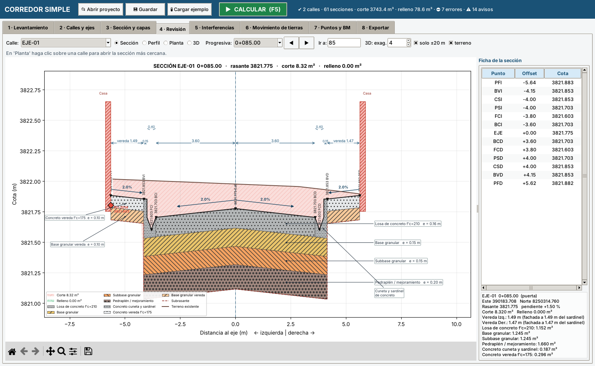

# Corredor Simple: diseño de pistas y veredas

Programa para topógrafos e ingenieros de obras de pistas y veredas urbanas. Con el **levantamiento
codificado**, el **eje**, el **perfil** y la **sección típica**, arma el corredor de cada calle y entrega:

- **Secciones transversales** listas para revisar: tramas por material, flechas de anchos y
  pendientes, cotas, rótulo de cada capa, y corte y relleno sombreados.
- **Perfil longitudinal con guitarra**: cota de terreno, cota de rasante, altura de corte o relleno y
  progresiva.
- **Interferencias**: puertas y cocheras enterradas, tapas de buzones y cajas a nivelar, y postes,
  árboles o grifos en calzada, cuneta, sardinel o vereda, con su paso libre.
- **Veredas** recortadas automáticamente donde la casa o el muro no dejan el ancho de diseño.
- **Movimiento de tierras**: áreas, volúmenes por área media, curva de masa, eliminación con
  esponjamiento, material de préstamo y volumen de cada capa (losa, base, subbase, pedraplén…).
- **BM numerados y ubicados** respecto a las calles (progresiva, lado y distancia al eje).
- **Puntos de replanteo** por superficie (terminado y cada capa) con lectura de mira, exportables
  a la estación total.
- Informe en **Excel** y **PDF**.



## Cómo empezar

1. Instala Python 3.12 desde python.org (marca *tcl/tk* y *Add to PATH*).
2. Haz doble clic en `iniciar.bat`, o crea el ejecutable con `construir_exe.bat`.
3. Pulsa **Cargar ejemplo** y luego **CALCULAR (F5)**.

### Flujo de trabajo

| Pestaña | Qué haces |
|---|---|
| **1 · Levantamiento** | Importas tu archivo de la estación total (`punto, este, norte, cota, código`). La app interpreta los códigos (ver **[docs/CODIGOS.md](docs/CODIGOS.md)**) y muestra cada tipo con su color y símbolo. La lista de etiquetas se puede editar. |
| **2 · Calles y ejes** | Una fila por calle: bombeo, ancho de calzada y ancho de vereda. El eje se define con *origen + azimut + longitud*, con números de punto del levantamiento o **con clics en la planta**. El perfil va por tramos encadenados: editas la pendiente o la cota final, y con *✂ Partir* agregas un quiebre. La vista previa se actualiza al instante. |
| **3 · Sección y capas** | Capas de calzada y de vereda (cm), cuneta por tramo y todos los parámetros. Los normativos aparecen en rojo hasta que los confirmes. |
| **4 · Revisión** | Sección en cualquier progresiva (con ◀ ▶ o *Ir a*), perfil con guitarra, planta (un clic abre la sección) y 3D. A la derecha, la ficha de la sección con las cotas de cada punto. |
| **5 · Interferencias** | Tabla de puertas, cocheras y elementos con su estado y qué hacer. Doble clic abre la sección. |
| **6 · Movimiento de tierras** | Tabla por calle o resumen, gráfico de áreas y curva de masa, y partidas para el metrado. |
| **7 · Puntos y BM** | Los BM con su ubicación y los puntos de replanteo filtrados por calle, superficie y código. Se exportan o copian a Excel. |
| **8 · Exportar** | Excel, PDF y CSV. LandXML y DXF para Civil 3D quedan para la siguiente etapa. |

Cuentas verificadas a mano: **[docs/VERIFICACION.md](docs/VERIFICACION.md)** (23 pruebas automáticas:
`python -m pytest`).

## Supuestos de diseño (confírmalos)

| Tema | Lo que hace la app |
|---|---|
| Sección | Calzada con bombeo desde el eje. Cuneta en V fuera de la calzada. Sardinel con cara vertical. Vereda que sube hacia la fachada. |
| Capas | Paralelas a la rasante. La losa ocupa solo la calzada; las capas granulares siguen bajo la cuneta y el sardinel. Las de vereda son paralelas a la vereda. |
| Subrasante | Fondo de la última capa (calzada) y fondo de la base de vereda. Corte y relleno de fachada a fachada. |
| Fachadas | Se toma la línea CA, MU o LP más cercana en dirección perpendicular al eje. La vereda se recorta (o solo se avisa) y es ERROR si queda bajo el mínimo. |
| Puertas | Umbral − vereda proyectada en la fachada: negativo = enterrada. Se propone bajar la vereda 2 cm bajo el umbral. |
| Cocheras | Dos puntos (COI y COF). Se propone rebajar el sardinel (3 cm sobre el borde de calzada) y se revisa la pendiente de la rampa (máx. 12 %, por confirmar). |
| Tapas | Se comparan con la superficie de diseño en su ubicación; tolerancia de 2 cm. |
| Obstáculos | Error en calzada, cuneta o sardinel. En vereda se revisa el paso libre (mín. 0.90 m, por confirmar). |
| Cruces | La primera calle de la lista manda. La secundaria se interrumpe en la cara de sardinel de la principal. Las esquinas quedan para la siguiente fase. |
| Tierras | Área media cada 10 m más puntos notables. Esponjamiento 25 %, contracción del relleno 15 % y reutilización 0 % (editables). |

## Estructura

```
CorredorSimple.py      entrada (ventana o consola: python CorredorSimple.py calcular <proyecto> <salida> [BM lectura])
corredor/
  codigos.py           lista de etiquetas de campo
  levantamiento.py     interpretación del levantamiento (líneas, puertas, cocheras, elementos, BM)
  datos.py             lectura, validación y guardado del proyecto
  geometria.py         eje, progresivas, rasante
  terreno.py           superficie TIN
  seccion.py           sección típica, capas, corte y relleno
  motor.py             corredor, cruces, fachadas, interferencias, BM, volúmenes, balance
  replanteo.py         tablas de eje, puntos y capas con lectura de mira
  graficos.py          planta, sección, perfil con guitarra, tierras y 3D
  exportar.py          Excel, PDF, CSV (y LandXML/DXF para Civil 3D)
  app.py               interfaz
datos_ejemplo/         proyecto de prueba
pruebas/               pruebas automáticas
docs/                  códigos, verificación, guía Civil 3D, capturas
```
